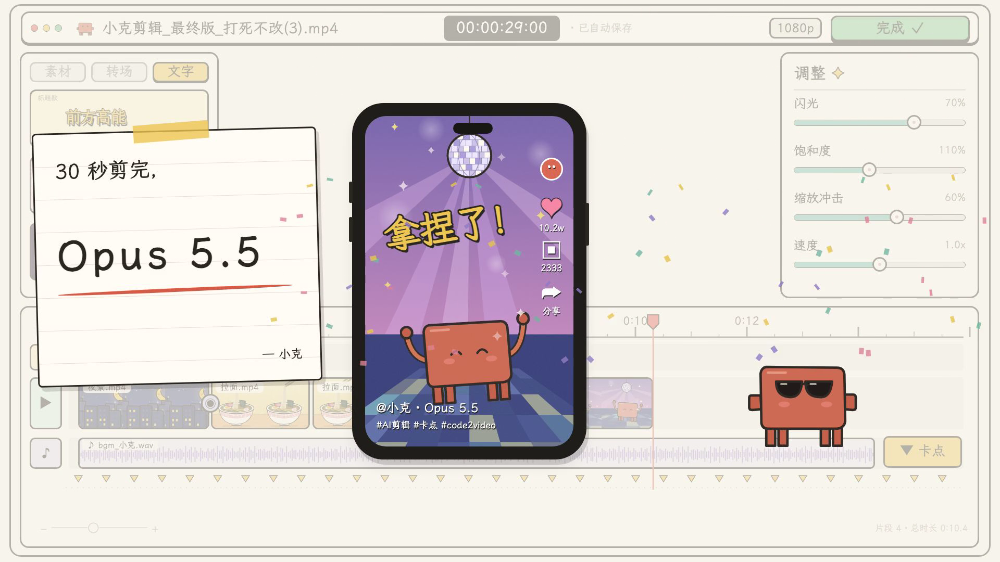

# 小克 30 秒剪完一条片 · Remotion 复刻

用 Remotion、React 和 SVG 近似重绘的 30 秒手绘剪辑软件小剧场：小克拖入素材、剪去废片、添加转场与字幕、撤销错误、调色、卡点并完成导出。

原公开片段页面：[Motionface · 小克剪辑片段](https://motionface.cc/?recording=bfa66bb1-df13-4166-88a0-54a8b7fd531f)
片段 ID：`bfa66bb1-df13-4166-88a0-54a8b7fd531f`

本工程是可编辑的组件动画，画面采用 SVG 与界面组件近似重绘。原始参考视频、抽帧、签名下载地址及绑定凭证均不包含在公开仓库中。声音为本工程自行合成的编辑音效与轻节拍，用于替代原音轨；没有旁白，也没有复制参考音轨。



## 启动与渲染

需要 Node.js 18 或更高版本与 npm。依赖已锁定为 Remotion `4.0.533`、React `19.2.4` 和 TypeScript `5.8.3`。首次渲染时，Remotion 可能需要下载浏览器运行环境。

获取工程并安装依赖：

```bash
git clone https://github.com/snowtank/motionface-xiaoke-remotion.git
cd motionface-xiaoke-remotion
```

在仓库根目录执行：

```bash
npm ci
npm run dev
```

Studio 使用 [http://localhost:3001](http://localhost:3001)，选择 `XiaokeEdit` 即可拖动时间轴预览。

```bash
# TypeScript 检查
npm run typecheck

# 导出第 390 帧（13 秒处）的静帧
npm run still -- --frame=390

# 导出完整视频
npm run render
```

静帧输出到 `out/xiaoke.png`，视频输出到 `out/xiaoke.mp4`。`out/` 为本地生成目录，不加入版本控制。

| Composition | 分辨率 | 帧率 | 帧数 | 时长 |
| --- | --- | --- | --- | --- |
| `XiaokeEdit` | 1920 × 1080 | 30 fps | 900 | 30 秒 |

## 30 秒内容

| 时间 | 动作 |
| --- | --- |
| 0–1 秒 | 代码窗口逐字输入，切入手绘工作台 |
| 1–2 秒 | 软件窗口、素材库、手机预览、调整面板和时间线出现 |
| 2–5 秒 | 小克“开工”，伸长手臂拖入夜景、拉面、柴犬与舞池素材，音轨铺开 |
| 5–8 秒 | 拉面失焦，标出废片并剪切；灰色片段落入垃圾桶 |
| 8–9 秒 | 时间线补位，小克收手并切换工具 |
| 9–12 秒 | 打开转场面板，为素材连接处添加转场标记 |
| 12–14 秒 | 打开文字面板，拖入黄色字幕，预览逐字出现标题 |
| 14–16 秒 | 出现重复字，小克按 Ctrl+Z 撤销，显示“已修正” |
| 16–20 秒 | 操作闪光、饱和度和缩放冲击滑杆；舞池色彩夸张后恢复 |
| 20–22 秒 | 小克移到音轨旁，伸手点击“卡点” |
| 22–24 秒 | 黄色节拍标记依次出现，角色随节奏轻跳 |
| 24–26 秒 | 伸手点击导出，按钮显示渲染进度并完成 |
| 26–28 秒 | 软件工作台淡出为背景，手机放大，便签出现并写字 |
| 28–30 秒 | “Opus 5.5”“拿捏了！”、社交界面、墨镜小克与彩纸庆祝收尾 |

参考画面中的“Opus 5.5”等文字仅为复刻内容，不代表本工程调用了该名称对应的模型或服务。

## 源码结构与修改方式

```text
src/
  index.ts                 # registerRoot 入口
  Root.tsx                 # Composition 与分辨率、帧率、总帧数
  XiaokeEdit.tsx            # 软件 UI、镜头、时间线、小克操作和结尾
  SceneArtwork.tsx         # 小克角色及四种素材的 SVG 图案
public/
  fonts/                   # LXGW WenKai Regular 与 OFL 授权
  audio/editor-foley.m4a    # 原创合成音效，Remotion 实际使用的音轨
scripts/
  generate-audio.py         # 使用 Python 标准库生成 WAV
  validate-render.py        # ffprobe 规格检查与 ffmpeg 完整解码
docs/
  reference-analysis.md    # 参考画面的构图、配色与分镜分析
```

- 修改故事文字：编辑 `XiaokeEdit.tsx` 中 `Terminal`、`Header`、`Library`、`Comic`、结尾便签等组件的文案。文件名映射位于 `sceneNames`。
- 修改素材图案：编辑 `SceneArtwork.tsx` 的 `SceneArtwork` 和 `Mascot`。四种场景键为 `city`、`ramen`、`cat`、`dance`；其中 `cat` 对应当前画面里的柴犬卡通。素材库、手机和时间线复用这些图案。
- 修改剪辑动作：`Timeline` 与 `layout()` 控制片段、文字轨、波形和剪切补位；`Puppet` 控制小克位置、长臂操作和提示语；`controls()` 控制调整面板的滑杆。
- 修改镜头与节奏：`cameraKeys` 定义时间、缩放和平移；`playhead()` 定义播放头位置。主组件使用 `t = frame / 30`，时间条件单位为秒。改动时间点时同步检查角色、预览场景、镜头和音效。
- 修改总长度或帧率：在 `Root.tsx` 调整 Composition，同时同步主动画中的秒/帧换算、音效长度和验证脚本的预期规格。只改 Composition 不会自动延展剧情。
- 修改整体配色：`XiaokeEdit.tsx` 顶部提供纸面、墨线、黄色、砖红和青绿常量；场景内部配色在 `SceneArtwork.tsx`。

动画使用当前帧驱动，重复渲染时保持相同的构图与节奏。界面是一段动画展示，按钮不执行真实剪辑或导出操作。

## 字体和音效

中文使用随仓库提供的 **LXGW WenKai Regular（霞鹜文楷）**，字体文件位于 `public/fonts/LXGWWenKai-Regular.ttf`。字体采用 SIL Open Font License 1.1，随附授权文件为 [public/fonts/OFL.txt](public/fonts/OFL.txt)。该字体接近参考的手写感，但不是对参考字体身份的认定。

音效源脚本仅依赖 Python 标准库。生成 WAV 后，使用已安装的 FFmpeg 转成工程实际引用的 AAC/M4A：

```bash
python3 scripts/generate-audio.py
ffmpeg -y -i public/audio/editor-foley.wav -c:a aac -b:a 160k -ar 48000 -ac 2 public/audio/editor-foley.m4a
```

生成结果为 30 秒、48 kHz、双声道。`editor-foley.m4a` 随仓库提供，因此正常预览和渲染不需要 Python 或 FFmpeg。WAV 为本地中间文件，不提交仓库。音效包括纸擦、鼠标点击、剪切、撤销、轻节拍与导出完成铃声，不包含外部采样。

## 验证导出文件

安装可从命令行调用的 `ffprobe` 与 `ffmpeg` 后，执行：

```bash
python3 scripts/validate-render.py

# 也可指定其他输出路径
python3 scripts/validate-render.py out/xiaoke.mp4
```

脚本检查 1920 × 1080、30 fps、900 帧、30 秒视频、AAC 48 kHz 双声道音轨，再完整解码视频和音频。结果写到 `docs/validation.json`，检查失败时以非零状态退出。该脚本验证文件规格和可解码性，画面相似度及文字排版还需通过 Studio 或静帧检查。

本次导出已通过 TypeScript 检查、900 帧完整渲染、关键帧人工检查和音视频全量解码。具体规格见 [docs/validation.json](docs/validation.json)。
